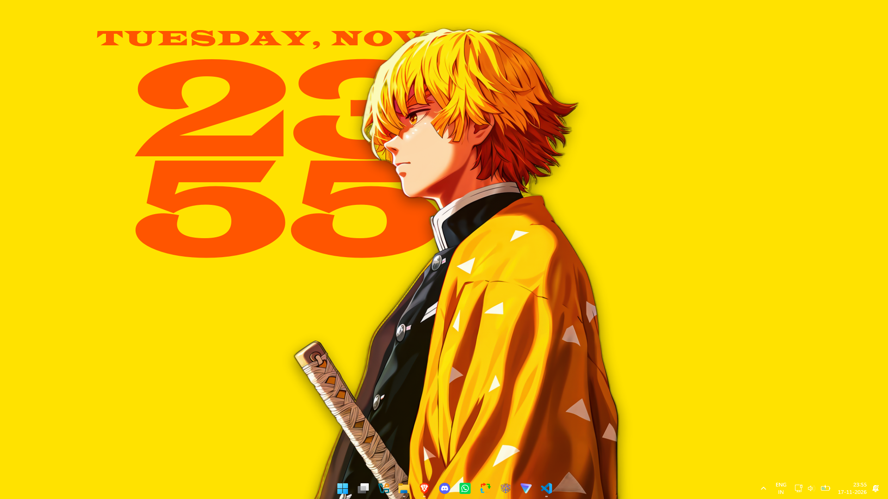
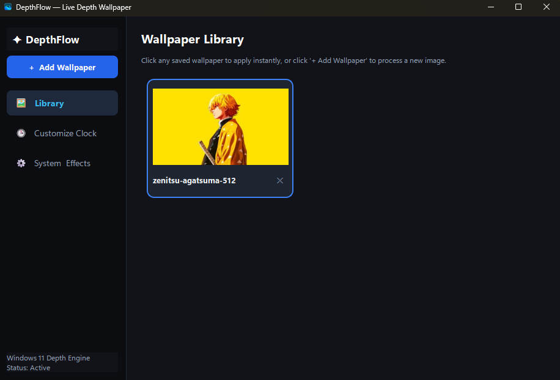
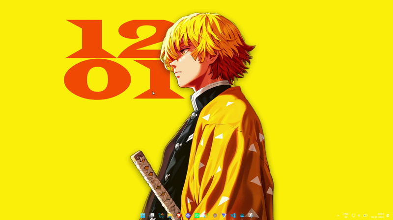

<div align="center">

# ✦ DepthFlow

**An AI-powered live depth wallpaper engine for Windows 11.**

Separate foreground subjects from any wallpaper, layer a customizable clock behind the subject, and bring your desktop to life with smooth 3-plane 3D mouse parallax—all while idling under ~100 MB of RAM.

[](https://gemini.google.com/)

[](https://github.com/abh1sv/DepthFlow/releases)
[](https://www.python.org/)

[Download Latest Release](https://github.com/abh1sv/DepthFlow/releases) · [Report a Bug](https://github.com/abh1sv/DepthFlow/issues) · [Request a Feature](https://github.com/abh1sv/DepthFlow/issues)

</div>

---

## 📸 Preview

<div align="center">
  
  <br /><br />
  
</div>

## 🎬 Live Demo

<div align="center">
  
</div>

## ✨ Features

- **Offline AI Subject Segmentation:** Automatically separates subjects from any wallpaper using `rembg` (`isnet-general-use`), complete with edge feathering and pre-baked 3D drop shadows.
- **3-Layer 3D Mouse Parallax:** Independent depth motion across **Background**, **Clock**, and **Foreground** layers.
- **6 Built-In Clock Styles:**
  - **Liquid Glass** — Real-time frosted background refraction with specular rim highlights.
  - **Classic Horizontal** — Clean, bold iOS-inspired lock-screen typography.
  - **Stacked Vertical** — Large two-line hour/minute layout.
  - **Editorial Serif** — High-contrast magazine styling.
  - **Tech Mono** — Minimalist dot-separated monospace clock.
  - **Hollow Outline** — See-through stroked typography.
- **Full Clock Customization:** Adjust X/Y positioning, font family, font size, 12h/24h format, date visibility, date-to-clock spacing, and automatic contrast color detection.
- **Smart Performance & Resource Management:**
  - Automatically unloads AI ONNX weights from memory 15 seconds after segmentation and trims Windows working-set RAM.
  - Separate toggles to pause 3D parallax during **Fullscreen** apps/games or **Windowed** foreground apps.
- **Native Windows Desktop Integration:** Pinned cleanly behind desktop icons and the taskbar with system tray controls and silent `--minimized` Windows startup support.

---

## 🚀 Quick Start (Windows Users)

1. Download **`DepthFlow.exe`** from the [**Releases**](https://github.com/abh1sv/DepthFlow/releases) page.
2. Run **`DepthFlow.exe`** (no Python installation required).
3. **First-Time Setup:** On first launch, DepthFlow automatically opens a PowerShell window to download the `isnet-general-use.onnx` segmentation model (~176 MB) into `%LOCALAPPDATA%\DepthFlow\models\`.
4. Click **`+ Add Wallpaper`** in the dashboard, choose any `.png`, `.jpg`, or `.webp` image, and customize your clock!

> **Tip:** Enable **"Launch Automatically When Windows Starts"** under **System & Effects** to boot silently into the system tray (`--minimized`).

---

## 🛠️ Run & Build from Source

### Prerequisites
- Windows 10 / 11 (64-bit)
- Python 3.11+

### Local Setup
```powershell
git clone [https://github.com/abh1sv/DepthFlow.git](https://github.com/abh1sv/DepthFlow.git)
cd DepthFlow

python -m venv venv
.\venv\Scripts\activate
pip install -r requirements.txt

python main.py
```

### Build Standalone `.exe`
```powershell
.\venv\Scripts\pyinstaller --noconsole --onefile --clean --noconfirm --name "DepthFlow" --icon="app.ico" --add-data "app.ico;." --collect-all rembg --collect-all onnxruntime --collect-all pymatting --collect-data scipy main.py
```
The compiled executable will be generated at `dist\DepthFlow.exe`.

---

## 📂 Data & Storage Locations

DepthFlow keeps your installation folder clean by storing all user data in `%LOCALAPPDATA%\DepthFlow\`:
- `config.json` — Your clock layout, color, and parallax preferences.
- `assets/presets/` — Processed foreground cutouts, backgrounds, and thumbnails.
- `models/` — Cached ONNX AI model weights.

---

## 🧩 Built With

- **[PySide6](https://doc.qt.io/qtforpython-6/)** — Hardware-accelerated translucent desktop overlay & dark dashboard UI
- **[rembg](https://github.com/danielgatis/rembg) & [ONNX Runtime](https://onnxruntime.ai/)** — Local AI foreground extraction
- **[Pillow](https://python-pillow.org/)** — Image fitting, Gaussian frosted refraction, and pre-baked drop shadows
- **[pywin32](https://github.com/mhammond/pywin32)** — Desktop Z-order pinning (`HWND_BOTTOM`), foreground window detection, and startup registry integration
